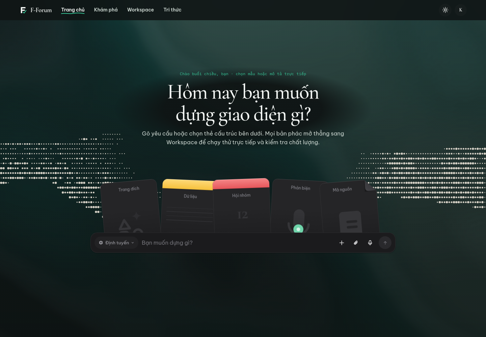
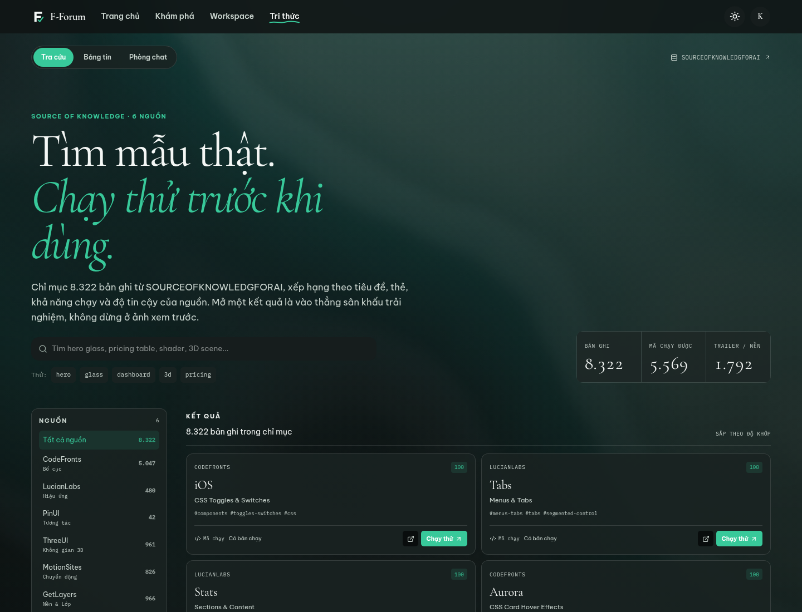
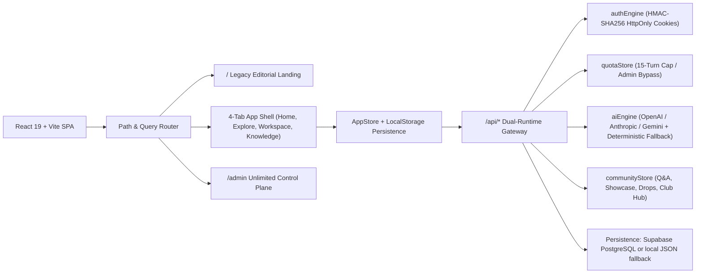

# F-FORUM v3

[](https://fforum3.vercel.app)

F-FORUM v3 is a developer workspace, curated UI/UX and AI resource index, and technical knowledge hub for building, inspecting, and exporting web interfaces. It combines a retained editorial landing experience at `/` with a four-part application shell (`Home`, `Explore`, `Workspace`, `Knowledge`), an AI build arena with sandboxed live preview, real system instructions and temperature controls, secret-scanned ZIP export, and a dual-runtime backend supporting local Express execution and Vercel Serverless Functions.

The Knowledge surface indexes **8,322 records** from [`broamstuck-cybr/SOURCEOFKNOWLEDGFORAI`](https://github.com/broamstuck-cybr/SOURCEOFKNOWLEDGFORAI), ranks them deterministically (title → tags/category → runnable source → source reliability), and routes every result into the Experience stage instead of stopping at a thumbnail.

## Screenshots

| Home | Knowledge search | Workspace |
|---|---|---|
|  |  |  |

Screenshots are desktop captures at 1440 px. Knowledge uses live vault data; Workspace shows a real session-instruction panel, not a mock overlay.

## Architecture



- **Frontend (`./src`)**: React 19, TypeScript, Tailwind CSS v4, Motion, Lucide icons, and JSZip.
  - `src/features/launchpad/HomeView.tsx` & `src/components/launchpad/ScrollStoryEngine.tsx`: Spatial Home Launchpad with Liquid Glass `PromptComposer`, client-side Blueprint Builder, and 4-Act GPU Scroll Storytelling Engine (`src/styles/story.css`).
  - `src/features/explore/ExperienceView.tsx`: live sandbox for CodeFronts/LucianLabs/PinUI, MotionSites trailer + prompt, a GetLayers background lab with real video/overlay/blur controls, and an external-demo handoff for ThreeUI pages that block iframes.
  - `src/features/workspace/`: 3-column Build Workspace (`WorkspaceView.tsx`, `Thread.tsx`, `LivePreviewFrame.tsx`, `DiffViewer.tsx`, `ChecksPanel.tsx`, `AiProjectSetupDrawer.tsx`) with starter prompts, per-session system instructions and temperature.
  - `src/features/knowledge/`: search-first Knowledge view (`KnowledgeView.tsx`), deterministic ranking (`knowledgeRanking.ts`) over `public/data/studio-vault.json`, source/category facets, runnable-only filter and paginated results.
  - `src/features/community/CommunityView.tsx` & `src/features/admin/AdminView.tsx`: 3-mode Knowledge hub (`Tra cứu`, `Bảng tin`, `Phòng chat`) and unlimited `/admin` control plane.
- **Backend (`./server` & `./api`)**: Shared TypeScript core in `./server` mounted by Express for local development and wrapped by Vercel Serverless handlers in `./api` for cloud deployment.
- **Persistence**: Optional Supabase PostgreSQL (`supabase/schema.sql`, 8 tables with RLS) stores users, quotas, community content, audit logs, changelog and per-user workspace projects. When `SUPABASE_URL` and `SUPABASE_SERVICE_ROLE_KEY` are unset, the server falls back to a local JSON store in `./data`. Guest workspaces stay in browser `localStorage`; signed-in users sync projects through `/api/projects/*`.
- **Design System**: Adaptive Dark (`Obsidian Foundry`) and Light (`Editorial Stone`) token palettes built on non-grid spatial layouts and traceable to the five libraries in `broamstuck-cybr/SOURCEOFKNOWLEDGFORAI`.

## Prerequisites

- Node.js 20.0.0 or newer
- npm 10.0.0 or newer

## Installation

```bash
git clone https://github.com/broamstuck-cybr/f_forumv3.git
cd f_forumv3
npm install
cp .env.example .env
```

## Usage

Populate `.env` with your AI provider credentials and session secret before starting the development server.

```bash
# Run both the Vite frontend and the Express API server concurrently
npm run dev

# Run frontend or API server individually
npm run dev:web
npm run dev:api

# Run static typecheck and lint verification
npm run typecheck
npm run lint

# Run the automated Node test suite
npm test

# Build production assets into ./dist
npm run build

# Confirm Supabase tables and RLS (requires SUPABASE_URL and SUPABASE_SERVICE_ROLE_KEY)
node scripts/verify-supabase.mjs
```

## Configuration

All runtime secrets and gateway parameters are read from environment variables. Copy `.env.example` to `.env` for local execution or configure them in your deployment platform.

| Variable | Required | Default | Description |
|---|---|---|---|
| `AI_API_KEY` | Yes | empty | Server-side API key for the upstream LLM provider |
| `AI_PROTOCOL` | No | `openai-compatible` | Upstream protocol (`openai-compatible`, `anthropic`, or `gemini`) |
| `AI_BASE_URL` | No | `https://api.openai.com/v1` | Base endpoint URL for the configured AI protocol |
| `AI_MODEL` | No | `gpt-4o-mini` | Default model identifier used for Workspace generation |
| `SESSION_SECRET` | Yes | empty | HMAC-SHA256 signing key for `HttpOnly` authentication cookies |
| `ADMIN_USERNAME` | Yes | `admin` | Dedicated administrator login identifier |
| `ADMIN_PASSWORD_HASH` | Prod | empty | Scrypt password hash (`salt:hash`) for production administrator login |
| `ADMIN_BOOTSTRAP_PASSWORD` | Dev only | empty | Local development bootstrap password when `ADMIN_PASSWORD_HASH` is unset |
| `SUPABASE_URL` | No | empty | Supabase project URL; enables PostgreSQL persistence (server-only) |
| `SUPABASE_SERVICE_ROLE_KEY` | No | empty | Supabase `service_role` key used by the server (never expose to the client) |
| `PORT` | No | `8787` | Local Express API listening port |

## Documentation

- [Product Specification](./docs/PRODUCT_SPEC.md)
- [UI Architecture & Design Tokens](./docs/UI_ARCHITECTURE.md)
- [Source of Knowledge Coverage (100%)](./docs/SOURCE_COVERAGE.md)
- [Vercel Deployment Guide](./docs/DEPLOYMENT_VERCEL.md)
- [Third-Party Notices & Attribution](./NOTICE.md)

## Contributing

1. Fork the repository and create a feature branch.
2. Ensure `npm run typecheck`, `npm test`, and `npm run build` exit with code `0`.
3. Verify that no secrets, `.env` files, or local absolute paths are included in staged commits.
4. Submit a pull request with a clear technical summary of the changes.

## License

Released under the [MIT License](./LICENSE). Third-party pattern attributions are documented in [NOTICE.md](./NOTICE.md).
