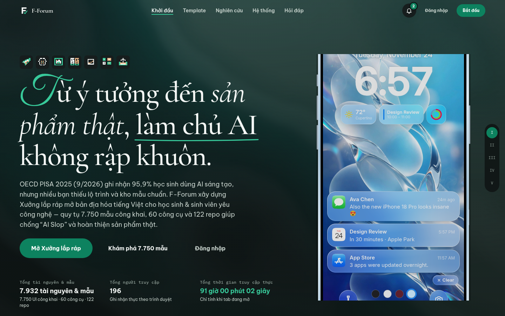
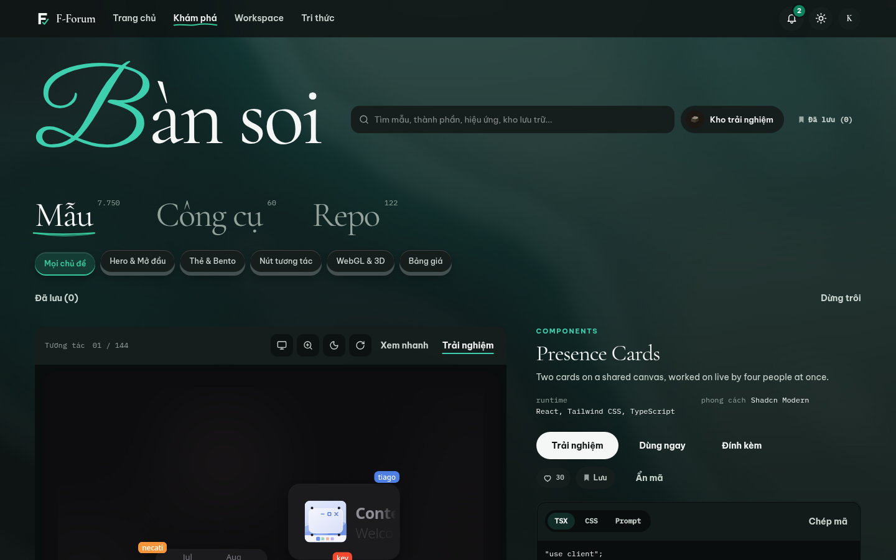
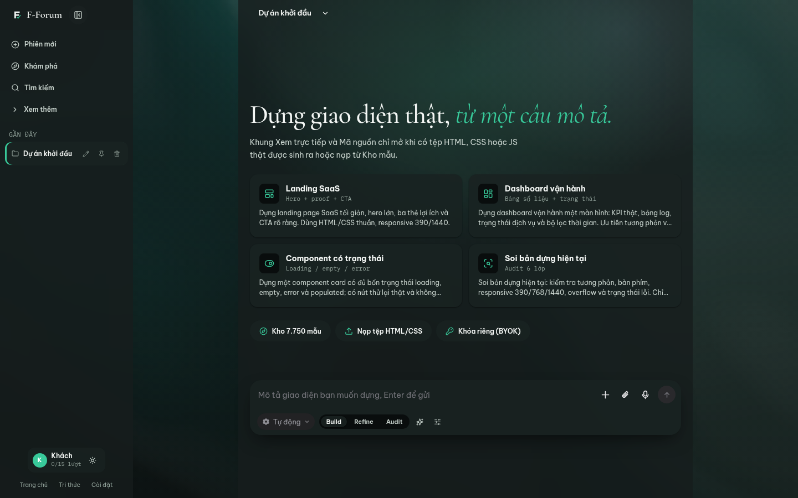
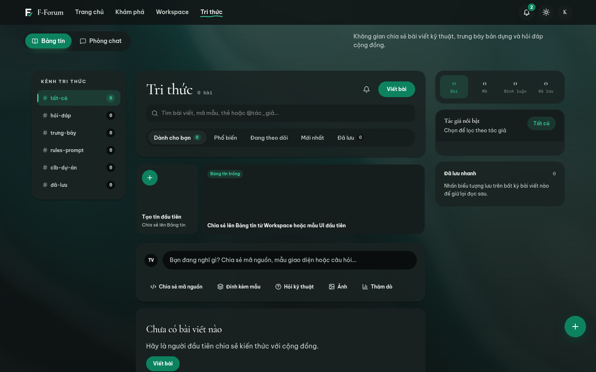
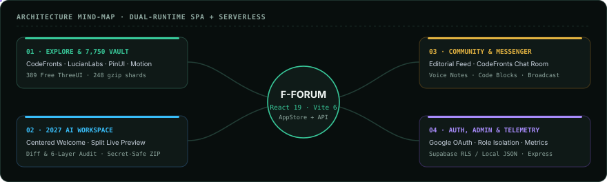
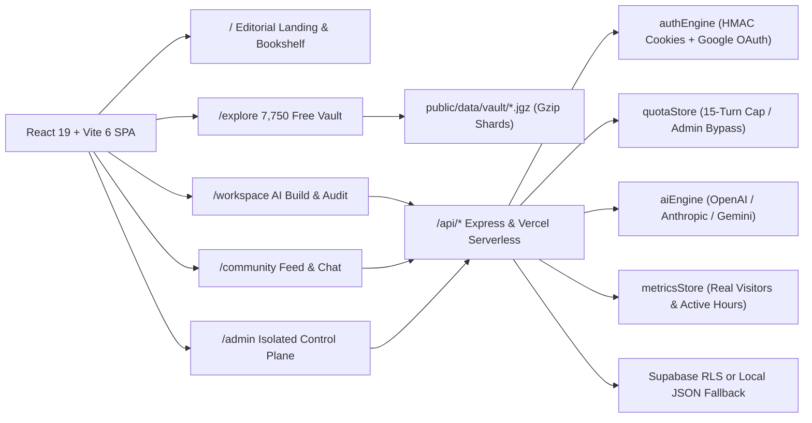

<div align="center">


<br />



<br />

[](https://fforum3.vercel.app)
[](https://react.dev)
[](https://www.typescriptlang.org)
[](./tests)
[](./LICENSE)

</div>

---

## Overview

**F-Forum v3** is a full-stack web workbench, curated public UI/3D archive, and technical community built for Vietnamese learners and frontend builders. Instead of leaving users to prompt blank pages from scratch, the app pairs **7,750 free, directly viewable UI and 3D specimens** with a sandboxed AI build workspace, an editorial feed, and a real-time messenger.

Every specimen in the vault comes from six public sources—CodeFronts (`5,047`), GetLayers (`966`), MotionSites (`826`), LucianLabs (`480`), ThreeUI public free (`389`, with all 548 Pro-only routes removed), and PinUI (`42`)—compressed into gzipped shards under `./public/data/vault/` so pages load fast without external vendor redirects.

## Live Product Gallery

Captures taken directly from the production deployment at [fforum3.vercel.app](https://fforum3.vercel.app) at `1440 × 900`:

<table>
  <tr>
    <td width="50%" align="center">
      <br />
      <sub><strong>Landing &amp; Live Metrics</strong> — Obsidian/Emerald palette, real visitor &amp; usage-hour telemetry, randomized MotionSites kits</sub>
    </td>
    <td width="50%" align="center">
      <br />
      <sub><strong>Explore Vault (7,750 Public Specimens)</strong> — Direct sandbox preview, Free ThreeUI motion clips, PinUI interactive demos</sub>
    </td>
  </tr>
  <tr>
    <td width="50%" align="center">
      <br />
      <sub><strong>2027 Spatial Workspace</strong> — Centered prompt canvas when empty; split Live Preview, Diff &amp; 6-layer audit open once code exists</sub>
    </td>
    <td width="50%" align="center">
      <br />
      <sub><strong>Knowledge Feed &amp; Messenger</strong> — Layered editorial feed cards, grouped chat bubbles, 28-bar voice notes, live BroadcastChannel sync</sub>
    </td>
  </tr>
</table>

## Architecture & Mind-Map

<div align="center">
  
</div>



## Key Capabilities

- **Curated Public Vault (`src/features/explore`):** 7,750 verified free resources across 6 libraries, plus 60 developer tools and 122 GitHub repositories. All Pro-only ThreeUI items and outbound redirect buttons are excluded so users stay inside the sandbox.
- **Spatial AI Workspace (`src/features/workspace`):** Keeps the preview pane hidden on blank sessions, opens a split `Live View / Source / Audit & Diff` workbench as soon as HTML/CSS/JS exists, checks 6 quality rules, and exports secret-scanned ZIP bundles.
- **Editorial Feed & Messenger (`src/features/community`):** Two focused tabs (`Bảng tin` and `Phòng chat`) with layered editorial cards, live code embeds, polls, grouped chat bubbles, 28-bar voice recording/playback, syntax-highlighted snippets, and cross-tab typing indicators.
- **Collector Bookshelf (`src/components/launchpad/GlacierBookShelf.tsx`):** 12-volume 3D tactile library with linen spine textures, physical shelf lighting, and a quick-jump reader dialog.
- **Security, Google OAuth & Isolated Admin (`server/authEngine.ts`, `src/features/admin`):** Real Google Identity Services ID-token verification via `oauth2.googleapis.com/tokeninfo`, strict separation between user and admin controls/notifications, live traffic & usage-hour analytics, and role management.

## Prerequisites

- **Node.js 20+** and **npm 10+**
- Optional: **Supabase** project for cloud persistence, **Google Cloud OAuth 2.0 Web Client ID** for Google Sign-In, and an OpenAI/Anthropic/Gemini-compatible API endpoint.

## Installation & Usage

```bash
git clone https://github.com/broamstuck-cybr/f_forumv3.git
cd f_forumv3
npm install
cp .env.example .env
npm run dev
```

Open `http://localhost:5173`. Both the Vite frontend and Express API run together in development; production builds target Vercel Serverless Functions via `./api/*`.

### Verification Commands

```bash
npm run typecheck   # TypeScript strict check
npm run lint        # Oxlint static analysis
npm test            # 28 unit & regression tests (auth, quota, vault, metrics)
npm run build       # Production Vite bundle
```

## Configuration

| Variable | Required | Purpose |
| --- | --- | --- |
| `SESSION_SECRET` | Yes (prod) | HMAC-SHA256 signing key for HttpOnly session cookies |
| `ADMIN_USERNAME` | Yes (admin) | Admin login identifier |
| `ADMIN_PASSWORD_HASH` | Yes (admin) | Scrypt password hash for root admin authentication |
| `GOOGLE_CLIENT_ID` | Optional | Google OAuth 2.0 Web Client ID verified by `/api/auth/google` |
| `VITE_GOOGLE_CLIENT_ID` | Optional | Public Client ID loaded by Google Identity Services in `AuthModal` |
| `AI_BASE_URL` / `AI_API_KEY` / `AI_MODEL` | Optional | Server-side AI gateway (users can also configure BYOK in Settings) |
| `SUPABASE_URL` / `SUPABASE_SERVICE_ROLE_KEY` | Optional | Cloud PostgreSQL persistence (`supabase/schema.sql`); falls back to local JSON in `./data` |

## Contributing & License

Pull requests that keep tests green (`npm test`), zero console errors, and clean token styling are welcome. Licensed under the [MIT License](./LICENSE).
