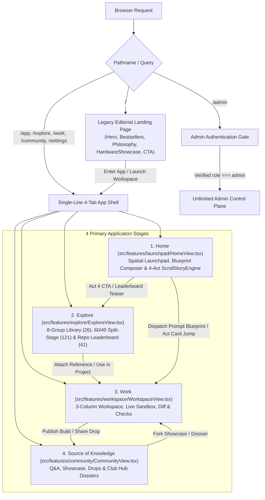
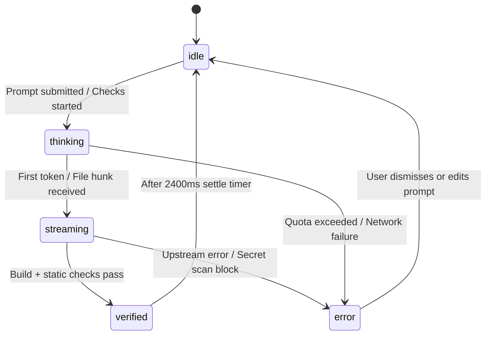

# F-FORUM v3 — UI Architecture & Design System

F-FORUM v3 implements a dual-theme, non-grid spatial architecture designed for high-density developer workflows while retaining the editorial presentation of the legacy landing page at `/`.

## 1. High-Level System & Navigation Flow

## 2. Non-Grid Spatial Layout Rules & 4-Act Scroll Choreography

F-FORUM v3 explicitly avoids uniform 3x3 SaaS card grids inside the application shell:

1. **Single-Line Navbar Discipline (`src/components/layout/AppNavbar.tsx`)**:
   - The top bar has a fixed height of `56px` (`3.5rem`) on desktop with `overflow-x: auto` fallback on narrow viewports so navigation tabs (`Home`, `Explore`, `Work`, `Source of Knowledge`) never wrap onto two lines.
2. **4-Act GPU Scroll Storytelling Engine (`src/components/launchpad/ScrollStoryEngine.tsx` + `src/styles/story.css`)**:
   - Mounted below the fold in `src/features/launchpad/HomeView.tsx` using a `560vh` pinned track (Acts 1–3) + `280vh` sticky dark horizontal manifesto track (Act 4).
   - Uses native `window.scrollY` + `requestAnimationFrame` lerp (`k = 1 - (1 - 0.14) ** (dt / 16.67)`) writing directly to DOM ref transforms (`transform`, `opacity`, `clip-path`, `filter`) with zero wheel hijacking and zero 60fps React re-renders:
     - **Act 1 (`01 Fan`)**: 7 technical 9x9 pixel SVGs (`shapeRendering="crispEdges"`) morphing into `"Ideas in Motion"` + 6-card arc fan (`step(R) = 2 * asin(1.05 * cw / (2 * R))`).
     - **Act 2 (`02 Craft`)**: Word-by-word blur reveal (`"From prompt to product / built through real craft"`) + 12 self-contained F-FORUM mini-UI artifact cards (`Navbar`, `PromptComposer`, `LiquidTabs`, `SplitStage`, `Arena 3-Col`, `LiveSandbox`, `UnifiedDiff`, `ChecksRunner`, `SecretScan`, `ClubDossier`, `RepoRank`, `KineticMark`) morphing through `Fan -> Scatter -> Pile -> Rotating Bottom Wheel`.
     - **Act 3 (`03 Portal`)**: Gated `clip-path: inset(... round 14px -> 0)` portal window expansion (`"Not just visuals / Real products that run"`) revealing a 3D-tilting Live Viewport Frame (`perspective: 900px`, yaw `-10deg..+10deg`, sine bob).
     - **Act 4 (`04 Manifesto`)**: Sticky dark horizontal kinetic manifesto track with per-character staggered reveal and 5 spring-overshoot badges (`zero slop`, `source-traced`, `sandboxed`, `open repos`, `verified checks`).
   - **Reduced-Motion Static Multi-Band Fallback**: Automatically switches to `height: auto` static editorial bands whenever `prefers-reduced-motion: reduce` or the in-app `reducedMotion` preference is enabled.
3. **3-Mode Floating Liquid Glass Command Dock (`Explore`)**:
   - **Mode 1 — `Thư viện Tài nguyên` (Spine-and-Drawer Index, 26 items)**: Vertical category rail across 8 groups, dense tabular rows with monospace metadata pills, and a slide-over detail drawer (`lucianlabs #273`).
   - **Mode 2 — `Kho Template UI/UX` (60/40 Asymmetric Split-Stage, 121 items)**: Desktop viewports (`>= 1024px`) lock a sticky 60% visual inspection stage on the left paired with a 40% scrubbable index rail on the right.
   - **Mode 3 — `Bảng Xếp Hạng Repo & Skills` (`src/features/explore/RepoLeaderboard.tsx`, 41 GitHub API-verified items)**: Asymmetric Top-3 Podium (`lg:grid-cols-[minmax(0,1.38fr)_minmax(0,1fr)]` with wide `#01` Lead Spotlight left + stacked `#02`/`#03` cards right) followed by an Editorial Ranked Ledger (`#04..#41`) across 4 categories (`Skills, Rules & Prompts`, `AI Agents & CLI`, `UI/UX & Motion`, `Local LLM & DevTools`) with 1-click `Use in Project` workspace attachment.
4. **3-Column Resizable/Collapsible Workspace (`Work`)**:
   - Uses a `26% / 48% / 26%` tri-pane workbench (`lucianlabs #101`) with `1px solid` hairline dividers (`var(--ux-border)`), independent scroll containers, and zero nested scrollbars on the document body.
5. **8px Spatial Rhythm & Contour Clamping**:
   - All padding, gaps, and structural heights snap to a `4px / 8px` spatial scale.
   - Every rounded surface (`border-radius: var(--ux-radius-md)` or `var(--ux-radius-lg)`) enforces `overflow: hidden` and clean border clamping so inner backgrounds, code blocks, and specular highlights never bleed past corners.

## 3. Adaptive Token Palette: Obsidian Foundry (Dark) & Editorial Stone (Light)

All components reference semantic CSS custom properties defined at `:root` and `[data-theme="light"]`. Raw hex values inside component templates are prohibited.

| Semantic Token | Dark (`Obsidian Foundry` — Default) | Light (`Editorial Stone`) | Usage |
|---|---|---|---|
| `--ux-bg-base` | `#0A0A0C` | `#F6F4F0` | Primary application canvas background |
| `--ux-bg-surface` | `#121317` | `#FFFFFF` | Primary panel, split-stage, and editor surface |
| `--ux-bg-elevated` | `#181A20` | `#EFECE6` | Elevated drawers, modals, command palette, hover rows |
| `--ux-bg-glass` | `rgba(18, 19, 23, 0.78)` | `rgba(255, 255, 255, 0.82)` | Top navbar and floating bar translucent fill (`backdrop-filter: blur(16px)`) |
| `--ux-text-primary` | `#F3F4F6` | `#141413` | Headlines, code editor primary text, active labels |
| `--ux-text-secondary` | `#9CA3AF` | `#575551` | Body copy, technical descriptions, inactive tabs |
| `--ux-text-muted` | `#6B7280` | `#87847E` | Timestamps, archive paths, keyboard shortcut hints |
| `--ux-border-subtle` | `rgba(255, 255, 255, 0.08)` | `rgba(20, 20, 19, 0.09)` | Hairline structural pane dividers |
| `--ux-border-strong` | `rgba(255, 255, 255, 0.16)` | `rgba(20, 20, 19, 0.18)` | Active input rings, focused card contours |
| `--ux-accent-primary` | `#D97736` | `#C25E1D` | Foundry Copper primary action & active indicator (zero generic AI purple) |
| `--ux-accent-secondary` | `#2DD4BF` | `#0F766E` | Telemetry Teal for verified status and diff additions |
| `--ux-status-success` | `#22C55E` | `#15803D` | Passing checks, verified resource badges |
| `--ux-status-warning` | `#F59E0B` | `#B45309` | Quota approaching cap (`>= 12 / 15` turns), unverified info |
| `--ux-status-danger` | `#EF4444` | `#B91C1C` | Failed checks, secret scanner block, quota exhausted (`15 / 15`) |
| `--ux-font-sans` | `'Inter', -apple-system, sans-serif` | `'Inter', -apple-system, sans-serif` | UI controls and body typography |
| `--ux-font-display` | `'Playfair Display', Georgia, serif` | `'Playfair Display', Georgia, serif` | Editorial headings on Landing and section titles |
| `--ux-font-mono` | `'JetBrains Mono', monospace` | `'JetBrains Mono', monospace` | Code editor, diff hunks, archive paths, telemetry counters |

## 4. Kinetic Morph F-Aperture Logo State Machine

The `KineticLogo` component in the top navigation bar acts as a real-time system telemetry indicator driven by `aiActivityState` from `AppStore`:

| State | Visual Geometry & Motion Specification | Reduced-Motion Behavior (`prefers-reduced-motion: reduce`) |
|---|---|---|
| `idle` | Geometric F-Aperture blades resting at `0deg` rotation; subtle border luminance (`1px solid var(--ux-border-strong)`). | Identical static geometry. |
| `thinking` | Outer aperture ring rotates in `45deg` stepped increments (`cubic-bezier(0.22, 1, 0.36, 1)`, `480ms`); inner core pulses in Foundry Copper (`--ux-accent-primary`). | Static copper indicator dot without rotation. |
| `streaming` | Aperture blades open `20%` wider; dual counter-rotating SVG stroke dash offset (`280ms` cycle) synchronized with incoming file buffer updates. | Steady open aperture with high-contrast copper ring. |
| `verified` | Blades snap into an octagonal lock contour (`180ms`) with Telemetry Teal (`--ux-status-success`) ring illumination before returning to `idle`. | Instant color transition to `--ux-status-success`. |
| `error` | Horizontal `4px` damped spring shake (`220ms`) and crimson contour highlight (`--ux-status-danger`). | Static crimson contour highlight without shake. |

## 5. Responsive Verification Contract (`390px`, `768px`, `1440px`)

Every view must pass layout and interactive verification across three mandatory viewport breakpoints:

1. **Mobile (`390px x 844px`)**:
   - Top navbar compacts brand subtitle and switches the 4 primary tabs into a horizontally scrollable single-line rail (`white-space: nowrap`, zero vertical text stacking).
   - Home `PromptComposer` container query (`@container pcmp (max-width: 560px)`) calibrates the 5 fanned cards (`11.5%`, `30.75%`, `50%`, `69.25%`, `88.5%` centers, `--pcmp-card-w: 19.2cqw`) so all 5 cards render 100% unclipped at `390px`.
   - `Explore` Floating Liquid Glass Command Dock scrolls horizontally across its 3 tabs (`Thư viện Tài nguyên`, `Kho Template UI/UX`, `Bảng Xếp Hạng Repo & Skills`); 60/40 Split-Stage and Top-3 Podium stack cleanly without horizontal overflow.
   - `Work` 3-column Workspace switches to a single active pane controlled by a persistent segmented switcher (`Architect` | `Stage & Code` | `Checks & Export`).
   - Zero horizontal page overflow (`document.documentElement.scrollWidth <= window.innerWidth`).
2. **Tablet (`768px x 1024px`)**:
   - Top navbar displays all 4 primary tabs and quota badge inline.
   - `Explore` displays a compact two-column rail + stage layout.
   - `Work` displays a 2-pane split (`Architect + Stage`) with `Checks & Export` accessible as a slide-over drawer.
3. **Desktop (`1440px x 900px`)**:
   - Full spatial choreography: 60/40 Split-Stage in `Explore`, full `26% / 48% / 26%` 3-column Arena in `Work`, and full side-by-side telemetry tables in `/admin`.
